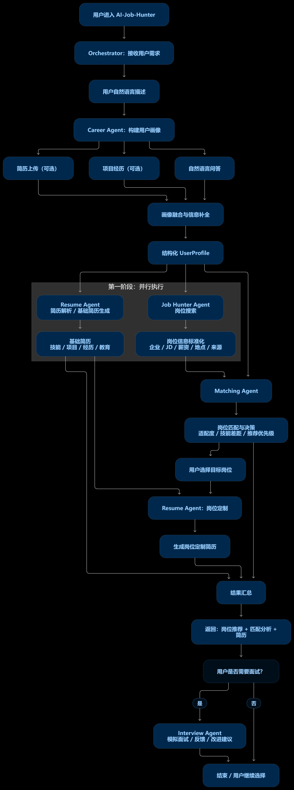

# Job Hunter

AI 求职决策与执行平台：**上传简历 → 建立用户画像 → 搜索匹配岗位 → 生成定制简历 → 模拟面试复盘**。

<p align="center">
  
</p>

**总流程**：Orchestrator 接收用户需求 → Career Agent 融合简历上传 / 项目经历 / 自然语言问答，构建结构化 `UserProfile` → 第一阶段并行：Resume Agent 产出基础简历（技能 / 项目 / 经历 / 教育），Job Hunter Agent 完成岗位搜索与信息标准化（企业 / JD / 薪资 / 地点 / 来源）→ Matching Agent 输出岗位匹配与决策（适配度 / 技能差距 / 推荐优先级）→ 用户选定目标岗位后由 Resume Agent 生成岗位定制简历 → 结果汇总返回「岗位推荐 + 匹配分析 + 简历」→（可选）Interview Agent 模拟面试、反馈与改进建议。

## 目录

| 路径 | 内容 |
| --- | --- |
| `frontend/` | React + TypeScript + Vite 前端（12 个页面） |
| `backend/` | FastAPI + SQLite 后端，接口清单见 [backend/README.md](backend/README.md) |
| `docs/` | 总流程图、设计笔记 [docs/design-notes.md](docs/design-notes.md) |
| `DESIGN-SPEC.md` | 设计规范（颜色、字号、间距、动效） |
| `job-hunter-wireframe-v2.html` / `job-hunter-keyframes.html` | 12 块画板线稿 / 关键帧演示页 |
| `jobs/`、`prompts/`、`scripts/` | 岗位库数据脚本 / 画板生成提示词 / 采集命令行 |
| `smoke-test.js` | 关键帧页的 DOM 冒烟测试 |
| `流程修改方案.md` | 项目计划书修改方案 |

## 快速开始

前端：

```bash
cd frontend
npm install
npm run dev        # http://localhost:5173
npm run build      # 产物在 frontend/dist/
```

后端（推荐 uv，仓库带 `uv.lock`）：

```powershell
uv sync
uv run uvicorn backend.app.main:app --reload --reload-dir backend
```

或者 venv：

```powershell
python -m venv .venv
.\.venv\Scripts\python -m pip install -r requirements.txt
.\.venv\Scripts\python -m uvicorn backend.app.main:app --reload
```

打开 http://127.0.0.1:8000/docs。数据库默认 `sqlite:///./ai_job_hunter.db`，首次启动自动建表，并给旧库补齐新增字段。

## 配置

从 `.env.example` 复制成 `.env`：

| 变量 | 用途 |
| --- | --- |
| `DEEPSEEK_API_KEY` | 模型 Key，抽取 / 草稿 / 面试接口必需；未配置返回 `503` |
| `DEEPSEEK_MODEL` / `DEEPSEEK_BASE_URL` | 默认 `deepseek-chat` / `https://api.deepseek.com` |
| `DATABASE_URL` | 默认 `sqlite:///./ai_job_hunter.db` |
| `OFFER_CAMPUS_API_KEY` / `OFFER_CAMPUS_API_BASE` | Offer先生校招数据开放平台采集；未配置 Key 时 `/jobs/collect` 返回 `503` |

## API 一览

完整清单与字段说明见 [backend/README.md](backend/README.md)，主干是这几组：

| 分组 | 接口 | 说明 |
| --- | --- | --- |
| 画像抽取 | `POST /api/v1/profiles/extract`（`/file`、`/bundle`） | 简历文本 / 文件 / 多来源合并 → 模型抽取画像草稿，带证据引用 |
| 画像确认 | `POST /api/v1/profiles/extract/confirm`、`GET .../pending`、`PUT .../personal-info` | 人工校对后落库；待补问题清单；个人信息按字段合并 |
| 简历 | `POST /api/v1/resumes/draft` | 基础简历草稿：要点带 `sources` 引用，按画像版本化落库 |
| 岗位 | `POST /api/v1/jobs`、`/jobs/ingest`、`/jobs/collect` | 手动录入 / 采集入库（幂等去重合并） |
| 核验 | `POST /api/v1/jobs/verify`、`/jobs/probe`、`/jobs/expire-stale` | 人工核验、来源探活、长期无证据自动过期 |
| 搜索匹配 | `POST /api/v1/job-search`、`/job-hunt`、`/job-matches`、`/job-fit` | 召回排序 → 逐需求加权匹配（`breakdown`）→ 一键跑完全流程 |
| 面试 | `POST /api/v1/interviews`、`/{id}/answers`、`/{id}/evaluation` | 模拟面试；结束后逐需求复盘 `answered` / `surface` / `unanswered` |
| 交易 | `GET /api/v1/products`、`POST /api/v1/orders`、`/{id}/payment`、`/{id}/deliveries` | 目录定价 → 下单 → 模拟支付 → 交付；金额只由服务端计算 |
| 账号 | `POST /api/v1/auth/register` / `login` / `logout`、`GET /api/v1/auth/me` | scrypt 密码 + 可撤销会话 token |
| 系统 | `GET /health`、`POST /api/v1/users`、`/api/v1/profiles` | 健康检查、用户与画像 CRUD |

## 联调

- 前端默认请求 `http://127.0.0.1:8000`，可用 `VITE_API_BASE` 覆盖。
- 上传页 / 岗位页需要 `DEEPSEEK_API_KEY`；后端未启动时前端自动回退本地估算，并在页面上方显示提示条。
- GitHub Pages 上没有后端，线上走本地回退；真正联调请在本地同时起 5173 和 8000。

## 验证

```bash
# 前端
cd frontend
npx tsc --noEmit                    # 类型检查
node scripts/check-css.mjs          # 跨文件选择器覆盖检查
node scripts/check-classes.mjs      # TSX 用到的 class 是否都有定义

cd ..
node smoke-test.js                  # 关键帧页冒烟测试
```

```powershell
# 后端
uv run pytest
```

## 在线演示

前端 GitHub Pages：https://qimahhhh.github.io/jobhunter/

首次部署需要在仓库 **Settings → Pages → Build and deployment → Source** 选择 **GitHub Actions**；之后每次 push 到 `main`，`.github/workflows/deploy.yml` 会自动构建并发布。生产构建的资源前缀为 `/jobhunter/`，本地 `npm run dev` 仍从根路径 `/` 提供服务。

## 演示数据

档案、问答、面试结果、岗位对比和登录状态保存在浏览器 `localStorage`，key 为 `jobhunter.state.v1`，刷新页面不会丢。清空：DevTools → Application → Local Storage 删除该 key，或在控制台执行：

```js
localStorage.removeItem("jobhunter.state.v1");
```

## 不入库的内容

- `node_modules/`、`dist/`、`.vite/`、`.tarballs/`
- `.venv/`、`__pycache__/`、`*.db`、`.env`
- 设计渲染图 `out/v2-frame*.png`、截图 `ui-shots/`（生成物，可重新产出）
